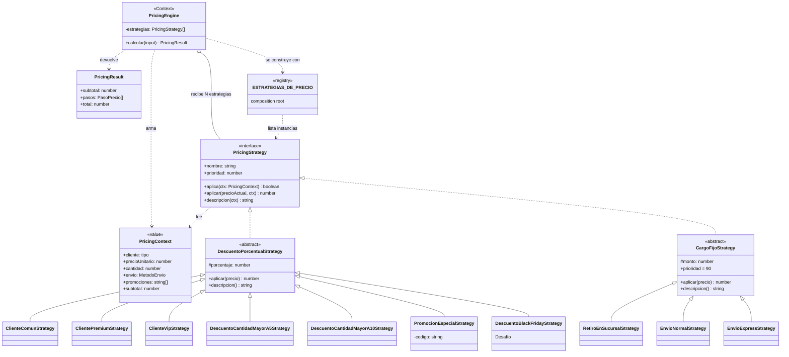
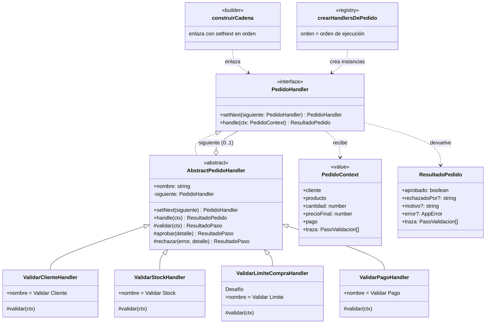
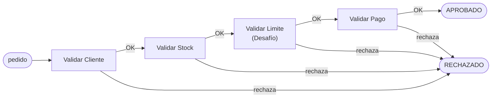
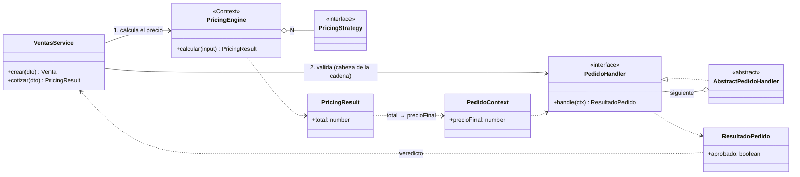
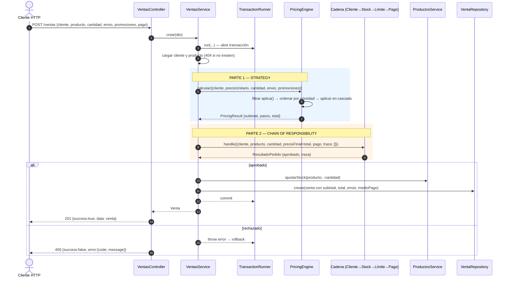
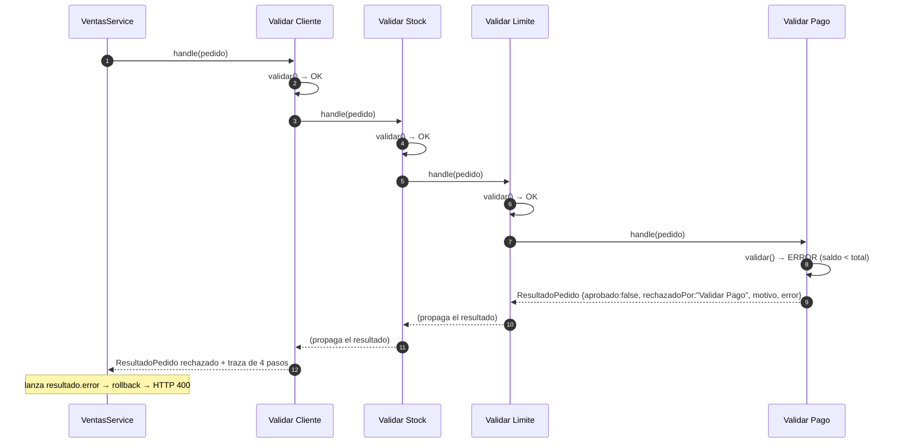

# Diagramas de clases (UML)

Los diagramas están en [Mermaid](https://mermaid.js.org/): se ven renderizados en GitHub, en VS Code (extensión *Markdown Preview Mermaid Support*) y en <https://mermaid.live>.

Contenido:

1. [Parte 1 — Strategy](#1-parte-1--strategy)
2. [Parte 2 — Chain of Responsibility](#2-parte-2--chain-of-responsibility)
3. [Relación entre los dos patrones](#3-relación-entre-los-dos-patrones)
4. [Secuencia de `POST /ventas`](#4-secuencia-de-post-ventas)
5. [Secuencia de un rechazo](#5-secuencia-de-un-rechazo-la-cadena-se-detiene)

Leyenda: `«interface»` contrato · `«abstract»` clase base · `<|--` herencia · `<|..` implementa · `o--` agregación · `..>` usa/depende. Las clases marcadas con **(Desafío)** se agregaron sin modificar las existentes.

---

## 1. Parte 1 — Strategy

**Cómo leerlo:** `PricingEngine` (Context) solo conoce la interfaz `PricingStrategy`. Las 10 clases concretas (más `DescuentoBlackFridayStrategy`, del Desafío) cuelgan de dos bases por herencia. El registry es el único que las nombra a todas.

---

## 2. Parte 2 — Chain of Responsibility

**Cómo leerlo:** la flecha `AbstractPedidoHandler o-- PedidoHandler` (el "siguiente") es lo que forma la cadena. `handle()` vive en la base (Template Method); cada hijo solo escribe `validar()`.

El orden resultante de la cadena:

---

## 3. Relación entre los dos patrones

`VentasService` es el **cliente** de ambos. El resultado de Strategy (`total`) pasa a ser dato de entrada de la cadena (`precioFinal`).

| | Strategy | Chain |
|---|---|---|
| Quién lo dispara | `VentasService` (paso 2 del flujo) | `VentasService` (paso 3) |
| Participantes que actúan | **Todos** los que `aplica()` | **Hasta** el primer rechazo |
| Salida | `PricingResult` (precio + pasos) | `ResultadoPedido` (veredicto + traza) |
| Se conectan por | `PricingResult.total` → `PedidoContext.precioFinal` | |

---

## 4. Secuencia de `POST /ventas`

---

## 5. Secuencia de un rechazo (la cadena se detiene)

Ejemplo del enunciado: **Validar Cliente → OK, Validar Stock → OK, Validar Pago → ERROR**.

Si el rechazo ocurriera en `Validar Stock`, los pasos 5 en adelante **no existirían**: `Validar Limite` y `Validar Pago` jamás reciben el pedido.
